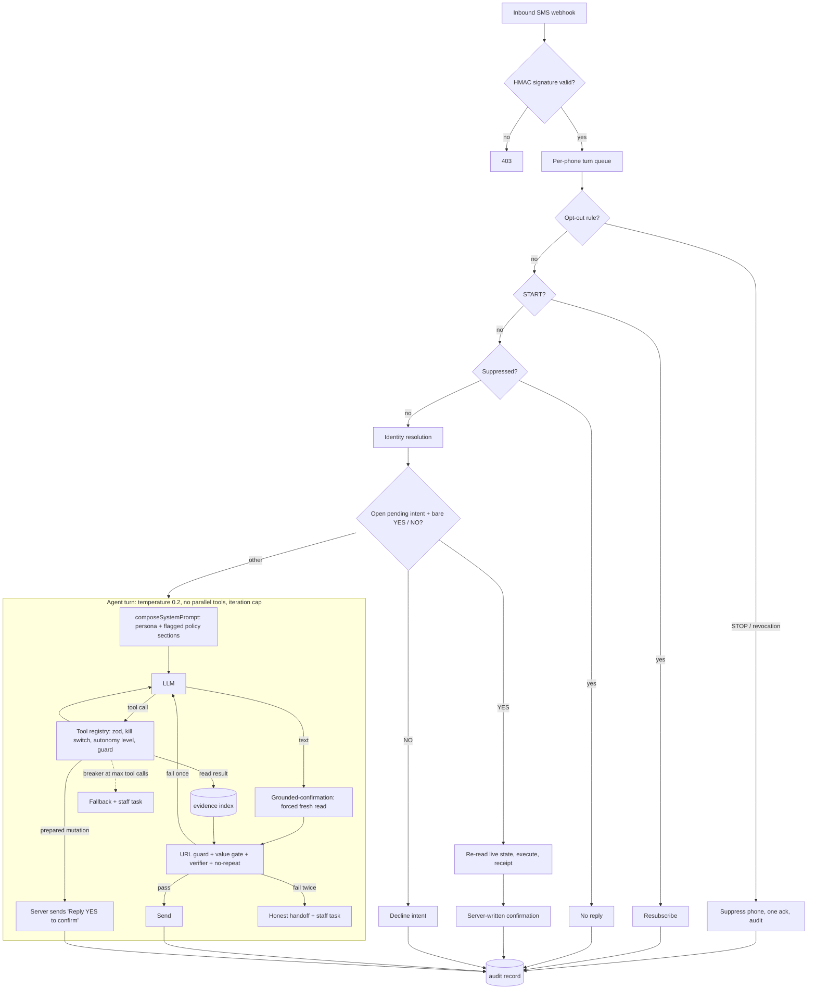

# agentic-front-desk

A reference implementation of an AI front desk that **transacts**: it books,
moves and cancels appointments over SMS (and, in production, voice) for a
fictional "Acme Wellness Studio". It is a clean-room extraction of the
patterns from a production system, rebuilt small enough to read in one
sitting and runnable fully offline.

The interesting part is not the LLM call. It is everything around it that
lets a model touch a real schedule without being trusted:

- compliance (opt-out, consent, calling hours) decided **before** the model runs;
- every booking change is two-phase: the model prepares, the customer
  replies **YES**, the server executes and writes the confirmation;
- a guarded tool registry (zod schemas, autonomy levels, kill switches, dry-run);
- post-model guards that block unsupported values, links and claims, with
  one redraft and then an honest handoff;
- an evidence verifier: **no sent or spoken claim without a server receipt**;
- an eval harness with variance-aware regression detection, used as a deploy gate.

## Architecture



| Module | What it does |
|---|---|
| `src/compliance/optout-policy.ts` | Deterministic STOP / natural-language revocation, "stop by" visit-sense stripping, near-miss typos |
| `src/compliance/consent.ts` | Hashed, versioned consent evidence; phone-wide idempotent suppression registry; IVR opt-out |
| `src/compliance/calling-window.ts`, `outbound-gate.ts` | Calling hours checked in every zone a number may be in; all-gates evaluation; reserve-then-recheck before dialing; conversation cap accounting |
| `src/webhooks/verify-signature.ts` | HMAC-SHA1, two schemes (raw body hex, sorted form base64), port-variant tolerant, timing-safe, fail-closed |
| `src/webhooks/basic-auth.ts` | Constant-time Basic auth for function-call webhooks |
| `src/tools/registry.ts` | Guarded tool registry: validate, kill switch, autonomy level, guard, execute, audit every decision; dry-run mode |
| `src/tools/booking-tools.ts`, `booking-store.ts` | Read tools, prepare-only mutation tools, receipt-producing in-memory store |
| `src/state/pending-intent.ts` | Two-phase confirmation state machine (supersede, expire, decline, fail) and the deterministic YES classifier |
| `src/state/turn-queue.ts` | Per-conversation serialization with hung-turn release |
| `src/agent/turn-loop.ts` | The bounded tool-use loop with post-model guards |
| `src/agent/inbound.ts` | Router order: opt-out, START, suppression, YES/NO, agent |
| `src/agent/compose-system-prompt.ts` | Base persona plus independently flagged policy sections |
| `src/agent/guards/*` | Grounded confirmation, value gate, outbound URL guard |
| `src/agent/audit.ts` | One audit record per turn; blocked drafts encrypted (AES-256-GCM, turn-bound) |
| `src/verifier/*` | Claim parser, evidence index (receipt minter, freshness, customer binding), proof engine |
| `src/voice/guards.ts` | Voice assent detection, card-data redaction, forbidden-output detector |
| `watchdog/warm_transfer_watch.py` | Audio-level dead-air watchdog that latches warm transfer off (simulated audio) |
| `evals/` | Golden-set harness: deterministic checks, optional LLM judge, variance-aware compare |
| `demo/` | Local SMS simulator with a scripted offline mock model; OpenRouter optional |
| `docs/voice-architecture.md` | Realtime-over-SIP, warm transfer and watchdog, evidence-gated speech |

## Design rules

1. **Compliance never depends on the model.** Opt-out is a deterministic
   rule set evaluated before identity, before the model, before anything.
   Suppression is keyed by phone and re-checked before every send.
2. **The model prepares; the customer confirms; the server executes.**
   Mutation tools are prepare-only. A bare "YES" is routed deterministically,
   live state is re-read, and the confirmation text is composed from the
   receipt. A hedge ("yes, but 4 instead") is not a yes.
3. **The tool owns the consequential sentence.** When a tool prepares a
   change, its server-written "Reply YES" text is sent verbatim.
4. **A guard may block a reply, never replace it with a confirmation.**
5. **Every value is grounded.** Times, dates, prices and counts must come
   from this turn's tool results, the customer's words or approved facts.
   Links must be supplied verbatim by the server.
6. **Bounded loops.** Temperature 0.2, no parallel tool calls, an LLM
   iteration cap and a tool-call breaker; both limits are clamped settings.
7. **Everything is audited.** One record per turn with route, model, prompt
   version, tool calls, results, every autonomy and guard decision.
8. **Evals gate deploys, with noise taken out.** A regression must fail 3 of
   3 runs on a check that never failed in a multi-run baseline.

## Run it

Requirements: Node 20, Python 3.10+. No API keys, no network.

```bash
npm install
npm run demo                     # scripted SMS walkthrough with the mock model
npm run demo:interactive -- --mock   # type your own texts
python3 watchdog/warm_transfer_watch.py --simulate dead-air
cd evals && python3 -m agent_evals eval
```

The demo prints each inbound text, the route that handled it, the tools
called, any guard that blocked a draft, and the reply. To use a real model,
set `OPENROUTER_API_KEY` and run `npm run demo:interactive`.

The mock model is deliberately gullible on its first draft for prompt
injection, customer-supplied links and "am I booked?" questions, so the
server-side guards visibly catch something.

## Tests

```bash
npx tsc --noEmit
npx tsx --test tests/*.test.ts   # compliance, webhooks, registry, state, guards, verifier, turn loop, hygiene
python3 -m pytest -q             # evals harness + dataset, watchdog
```

`tests/test_dataset_hygiene.test.ts` scans every text file in the repo and
fails on any phone number outside the fictional 555-01xx range, any email
not at example.com, any routable IP address, or any term from a private
scrub list (stored encoded). `evals/tests/test_dataset.py` applies the same
rules plus a fictional-name allow-list to the golden set.

## Evals

`evals/` is a port of the production eval harness with all data replaced by
synthetic records: booking, cancel, reschedule, booking-status questions,
opt-out (including a "stop by" near-miss that must *not* opt out), pricing,
membership changes, identity and shared phones, and three prompt-injection
cases.

- **Runner contract** (`agent_evals/runner.py`): records go to
  `evals/runner/run-turns.ts`, which drives this repo's real inbound pipeline
  against a freshly seeded store with the clock pinned to the record's time.
- **Deterministic checks** (`agent_evals/checks.py`): tool schema, must-call,
  outcome, claims backed by receipts, times backed by evidence, opt-out
  purity, output hygiene, required/forbidden text.
- **Judge** (`agent_evals/judge.py`, `judge_prompt.md`): optional
  pass/fail rubric for policy, groundedness and helpfulness; input is
  treated strictly as data; verdicts cached by content hash.
- **Compare** (`agent_evals/compare.py`): multi-run baseline, re-run of
  suspects, 3-of-3 rule, judged-rule drop threshold.

With the offline mock model every record passes every deterministic check.
That is a harness smoke test, not a model score: point
`AGENT_EVAL_MODEL=openrouter` at a real model to measure one.

## Production context

The production system these patterns come from ran as the front desk of a
single-location wellness studio (May to October 2026):

- **382 sessions booked autonomously for 196 customers** (63% completed)
- **2,873 AI-handled SMS turns across 631 contacts**
- **182 inbound voice calls answered**

## What was simplified

- **Storage.** A relational database with row locks and transactions became
  an in-memory store. The reserve-then-recheck pattern is kept, but there
  is no real concurrency control beyond the per-phone queue.
- **The agent loop** was condensed heavily. Production also had persona
  selection (member / prospect / win-back), FAQ-composition and
  payment-handoff guards, assent shortcuts, an orphaned-turn sweep and
  campaign context, all omitted.
- **Identity resolution** is reduced to phone lookup plus a first-name check
  for shared numbers.
- **The verifier** is a compact rewrite: a small sentence-level grammar
  instead of the original typed claim graph, no temporal-range claims, no
  price or address evidence types.
- **Voice** is documented, not shipped: no realtime session, SIP bridge or
  warm-transfer conference code. The watchdog runs on simulated audio.
- **Outbound calling** keeps the gate logic and cap accounting but has no
  dialer, preconnect or scheduler.
- **Evals** run against the mock model by default and have a small
  synthetic golden set; the production harness ran production code against
  scratch databases with frozen tool fixtures.
- Payments are out of scope. The production assistant never took payment
  either; the server issued tokenized links.

## License

MIT. See `LICENSE`.
