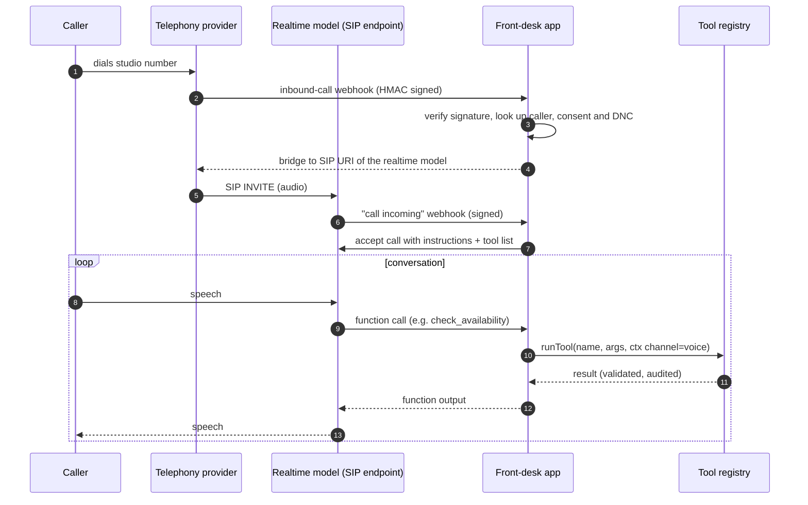
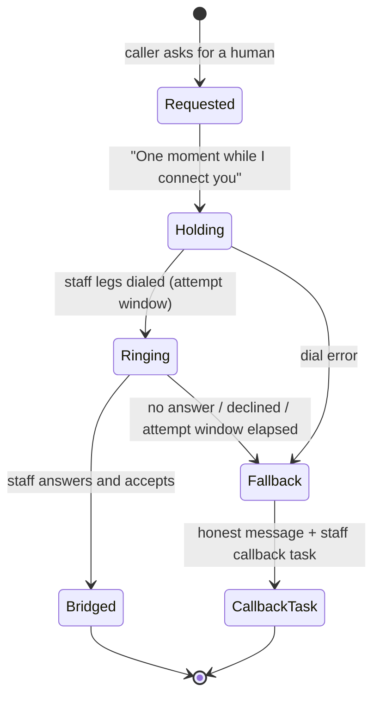
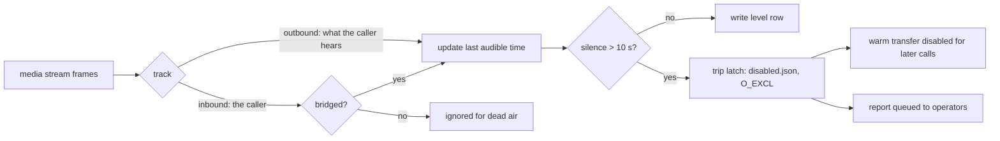
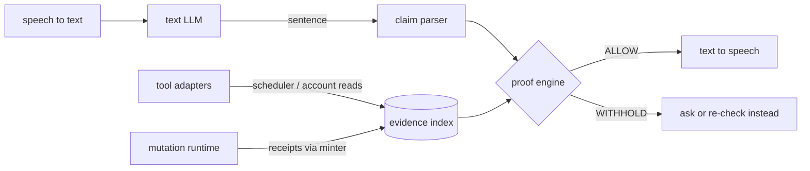

# Voice architecture

This document describes how the voice side of the front desk was built in
production. The code in this repository covers the pieces that are
channel-neutral (tool registry, opt-out and consent rules, voice guards,
the evidence verifier, the warm-transfer watchdog). The realtime session
itself depends on provider accounts and is described here rather than
shipped.

Three ideas carry over from SMS to voice unchanged:

1. **The model never owns a consequential sentence.** Bookings, cancels and
   moves are prepared by tools and confirmed by an explicit "yes"; the
   confirmation is spoken from server data.
2. **One tool registry.** Voice and SMS call the same zod-validated tools
   with the same autonomy gates and kill switches. A tool disabled for SMS
   is disabled for voice.
3. **No claim without a receipt.** Anything the agent says about the
   schedule, the account or an action must be backed by a server result.

## 1. Inbound calls: realtime speech-to-speech over SIP

Design notes:

- **AI disclosure in the first sentence** of every call. Recording, when
  enabled, is consented and retention-limited.
- **Signature checks on both hops.** The telephony webhook uses HMAC-SHA1
  (`src/webhooks/verify-signature.ts`); the realtime provider's
  "call incoming" event is verified with its own webhook secret before the
  app accepts the call.
- **Assent is deterministic.** "Yes" to a prepared change is recognized by
  `isExplicitVoiceAssent` (`src/voice/guards.ts`): an exact standalone
  affirmative confirms; any negation or hedge ("yes, but...") vetoes and
  the agent asks again.
- **Card data never reaches storage or the model.** Transcripts pass
  through `redactCardData` before persistence. Payments are never taken on
  the call; the server can send a tokenized link by text instead.
- **Forbidden output detector.** Price quotes and "someone will call you
  back within the hour" promises are caught by
  `detectForbiddenAssistantOutput` and replaced with a handoff.

## 2. Warm transfer with an audio watchdog

When a caller asks for a person, the agent places them on hold and rings
staff in a conference. The transfer is the riskiest moment on the call:
the model has stopped talking and the caller can only hear what the
conference plays.

Scripted rules: the agent may say "connecting you" only when a staff leg
is actually ringing; every failure branch ends in a truthful fallback line
and a staff callback task, never silence.

### The watchdog (`watchdog/warm_transfer_watch.py`)

A separate process subscribes to a media stream of each transferred call
(both tracks, 8 kHz mu-law) and computes **levels only**: dBFS per 20 ms
frame. No audio is recorded or written.

- Before the bridge, the caller saying "hello?" cannot hide dead air: only
  the track the caller hears is evaluated.
- The trip is an exclusive-create latch file, so the first trip's evidence
  survives; the current call is never hung up to disable the feature.
- The monitor's own stream failing is reported separately and does not
  trip the latch: a broken monitor is not a broken call.
- Stream tickets are short-lived HMAC tokens bound to one call id.

Run the simulation: `python3 watchdog/warm_transfer_watch.py --simulate dead-air`.

## 3. Evidence-gated speech (cascade runtime)

A second runtime was built as a classic cascade (streaming speech-to-text,
a text LLM, streaming text-to-speech) for staff testing. Its distinguishing
feature is a gate between the LLM and the speaker: **every sentence is
parsed into claims, and a claim is spoken only if server evidence proves
it.** The policy is "finish or ask, never silently partial".

The `src/verifier/` module is a compact rewrite of that gate:

| Claim kind | Example | Proven by |
|---|---|---|
| discourse | "Which day works for you?" | nothing needed |
| slot_open | "Thursday at 3:00 PM is open" | a fresh scheduler read containing that slot |
| slot_open (negative) | "Nothing is open Thursday" | a **complete** scheduler read for Thursday with no rows |
| appointment_exists | "You have a session Thursday at 3" | a fresh account read for the resolved customer |
| action_completed | "You're booked" | a server receipt minted this turn |
| public_fact | "First session is 8:00 AM" | the value appears in approved facts |

Evidence rules that matter in practice:

- **Receipts cannot be imported.** Only the mutation runtime holds the
  receipt minter (issued once per index). A model, a prompt or a parsed
  tool argument cannot create one.
- **Freshness.** Account reads expire after at most 60 seconds, and the cap
  cannot be raised. Any mutation bumps a revision that invalidates earlier
  reads, so "3:00 PM is open" cannot be said after 3:00 PM was just booked.
- **Customer binding.** Account evidence must belong to the resolved
  caller; a read for another household member proves nothing.
- **Uncovered spans withhold.** A sentence carrying a number that no frame
  explains is never assumed harmless.

The SMS turn loop in this repository runs the same verifier as one of its
post-model guards.

## What is not in this repository

- The realtime session runtime, provider configuration, SIP endpoints and
  phone numbers.
- Call recordings, transcripts and any production test corpus. All test data
  here is synthetic.
